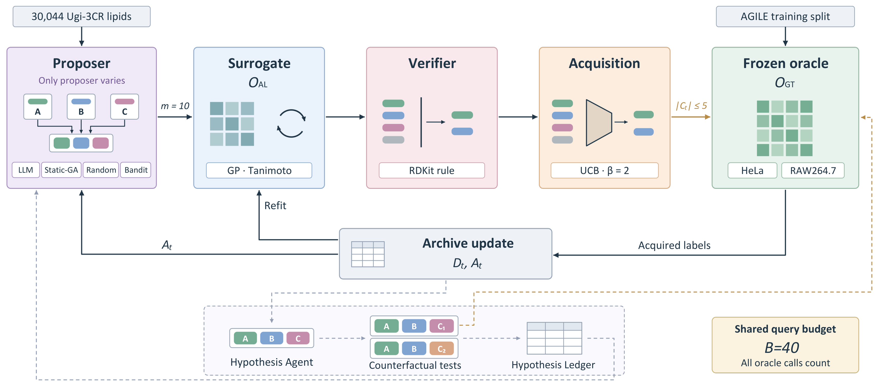

# Do LLM Proposers Improve Budgeted Search for Ionizable Lipids?

Code and reproducibility materials for the paper introducing **LEAF**
(Lipid Evolutionary Adaptive Framework), a matched-budget protocol for
testing whether language-model proposers improve combinatorial molecular
search for ionizable lipids relative to classical baselines.

## Abstract

Large language models are increasingly proposed as components of
molecular design pipelines, yet whether they improve search under a
fixed experimental budget remains untested against matched classical
baselines. Here we evaluate four language models as proposal operators
in a budgeted combinatorial search over 30,044 ionizable lipids, using a
frozen Gaussian-process oracle fitted to experimental transfection-potency
data and an identical acquisition function across all methods. None of
the four models improves hypervolume over genetic-algorithm or
random-search baselines across eight seeds and three data splits. The
dominant failure mode is duplication: 79.1% of acquisition-selected
queries from the smallest model repeat previously evaluated candidates,
and removing duplicates narrows but does not reverse the deficit while
increasing proposal cost. Larger models reduce duplication without
achieving superiority or statistical equivalence. Six further checks -
a zero-shot leakage probe, rank-only and chain-of-thought prompts, a
score-shuffle perturbation, an evidence-conflict probe, and a native
reasoning-mode proposer - show that models measurably engage with
injected potency information without this engagement translating into
better search outcomes. These results identify duplicate-driven query
waste, not model scale or prompt design, as the binding constraint on
current zero-shot language-model proposers under matched budgets.

## Architecture



Only the proposer varies across LLM, static-GA, random-search, and
Thompson-bandit methods. Every method shares the same Tanimoto-kernel
Gaussian-process surrogate, RDKit-based verification rule, UCB
acquisition, and frozen evaluation oracle, under an identical
oracle-query budget.

## Repository structure

```
LEAF/
├── leaf/                      # Core package
│   ├── agents/                 # Proposer implementations (LLM, rule-based) + prompt templates
│   ├── archive/                 # Pareto archive / non-dominated sorting
│   ├── baselines/               # Static-GA, random-search baselines
│   ├── configs/                 # YAML experiment configurations (one per reported run)
│   ├── data/                    # AGILE dataset loader + vendored raw data
│   ├── eval/                    # Experiment runner, significance testing, reproducibility logging
│   ├── fragments/                # Ugi-3CR vocabulary, fragment embedding, (de)composition
│   ├── oracle/                   # Frozen ground-truth oracle, active-learning surrogate, GP/kernel
│   ├── orchestrator/              # The budgeted search loop itself
│   └── tests/                     # Unit tests
├── scripts/                    # Experiment runners, figure generation, standalone diagnostics
├── reproducibility_package/     # Exact data-split indices and run manifest
├── figures/                      # Architecture diagram
├── environment.yml               # Main conda environment (exact pinned versions)
├── environment-pymol.yml         # Isolated environment for 3D structure rendering only
├── requirements.txt               # Pip fallback (exact pinned versions)
└── pyproject.toml
```

## Installation

A dedicated environment is strongly recommended — package-version drift
between runs is a confound this project explicitly tracks, and `rdkit`
is most reliably installed via conda.

```bash
conda env create -f environment.yml
conda activate leaf
pip install -e .
```

Pip-only fallback:

```bash
python -m venv .venv
source .venv/bin/activate        # Windows: .venv\Scripts\activate
pip install -r requirements.txt
pip install -e .
```

Verify the install:

```bash
python -c "import leaf; print('ok')"
pytest leaf/tests -q
```

### Optional: 3D structure rendering

`scripts/render_pymol.py` renders ball-and-stick structures of
best-found lipids and requires open-source PyMOL, which has a newer
`numpy` dependency than the rest of this codebase. It is kept in a
fully separate environment so the two never conflict:

```bash
conda env create -f environment-pymol.yml
conda activate pymol_env
python scripts/render_pymol.py
```

`scripts/embed_3d.py` (3D conformer generation via RDKit) runs in the
main `leaf` environment beforehand; only the rendering step needs
`pymol_env`.

## Data

The AGILE labeled dataset (`leaf/data/raw/agile/`) and its virtual
library extension (`leaf/data/raw/agile_extended/`) are vendored
directly; see `leaf/data/raw/README.md` for provenance and
`leaf/data/raw/agile/LICENSE_AGILE` for its license. The frozen oracle
(`leaf/data/processed/oracle_gt.pkl`, ~60 MB, excluded from this
repository) is regenerated by:

```bash
python scripts/run_e1_oracle_validation.py --freeze-oracle
```

## Reproducibility

- `reproducibility_package/split_indices.json` — exact random/scaffold-cold/chemotype-cold
  train-test partition indices (split-generation seed 0).
- `reproducibility_package/manifest.json` — mapping from reported results to the
  experiment configuration and command that produced them.
- Every run under `leaf/configs/*.yaml` logs its own manifest (config, git commit
  when available, and package versions) via `leaf/eval/reproducibility.py`.
- All reported statistics (bootstrap confidence intervals, Wilcoxon tests, Holm
  correction, TOST equivalence) are computed by `leaf/eval/significance.py`,
  not hand-calculated.

Run a single experiment:

```bash
python -c "from leaf.eval.run_experiment import run_one; run_one('leaf/configs/<config>.yaml', '<experiment>', '<method>', '<split>', <seed>)"
```

## License

Code is released under the MIT License (see `LICENSE`). The vendored
AGILE dataset carries its own separate license
(`leaf/data/raw/agile/LICENSE_AGILE`).
